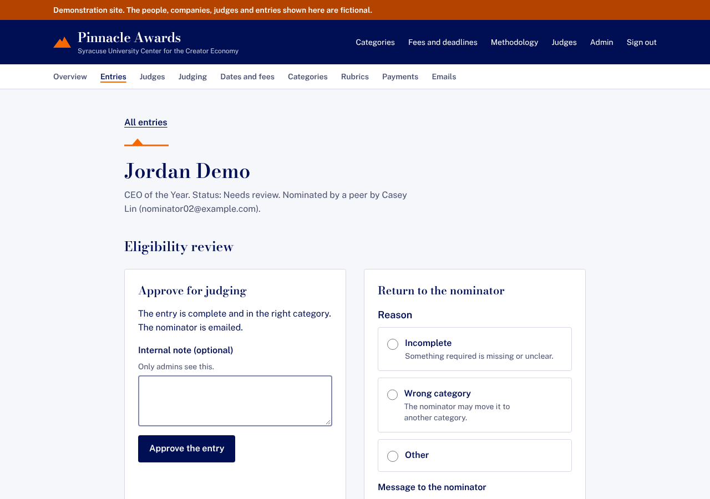
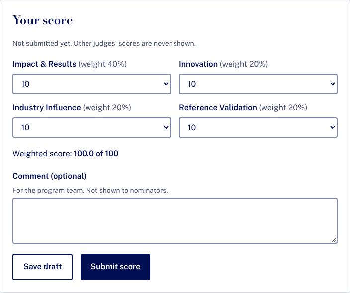
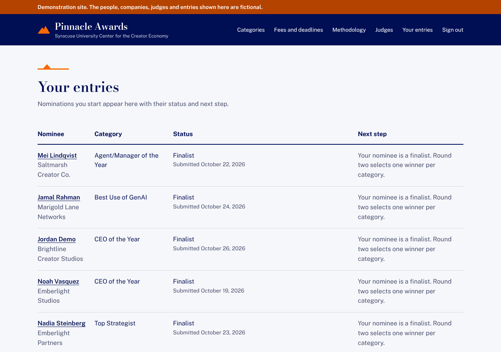

# Demo walkthrough

A repeatable demo of the Pinnacle Awards platform as built through #12: a nomination is entered and paid for, an admin approves it, a judge declares a conflict and is recused, round one is scored, and finalists are chosen and announced. All data is fictional (`example.com` / `example.org`), and payments use the built-in checkout simulator, so no money moves.

It takes about 15 minutes by hand. `npm run demo:walkthrough` runs the same steps in a browser and saves the screenshots shown below.

## Set up (once per demo)

Needs Node 24 and a local Postgres 16 with the `.env` from `.env.example` (`DATABASE_URL`, `BETTER_AUTH_SECRET`, `APP_URL`; keep `EMAIL_TRANSPORT=outbox` and `PAYMENTS_PROVIDER=mock`).

```bash
npm install
npm run db:reset && npm run db:seed -- --open-now   # fresh demo data, nominations open today
npm run dev                                         # http://localhost:3000
```

Set `DEMO_MODE=true` to show the "fictional data" banner.

**Signing in.** Go to **Sign in**, enter an address from the list below, then open **http://localhost:3000/dev/mailbox**, click the newest link, and confirm with **Sign in as …**. That mailbox exists only on the development outbox; in production the link is emailed. Use a separate browser profile, or a private window, for each person.

| Person | Email |
|---|---|
| Nominator | `nominator02@example.com` |
| Program admin | `admin@example.org` |
| Judges for CEO of the Year | `judge1@example.org` (Dana Whitfield), `judge4@example.org` (Tomás Herrera) |
| Judge brought in to cover a recusal | `judge2@example.org` (Marcus Ellery) |

The seed holds 9 categories, 63 entries (approved, awaiting review, returned and drafts), 57 paid entry fees and 6 judges. Each category has two judges per round.

## 1. Nominate (nominator)

1. **Your entries → Start a nomination.** Choose **CEO of the Year** and **I am nominating someone else**, then **Start the entry**.
2. Fill in the nominee (for example *Jordan Demo, Chief Executive Officer, Brightline Creator Studios*), a 250-500 word narrative, two outcomes with data points, and one reference. **Save draft** works at any point.
3. Choose **Save and review**. Anything missing is listed and linked to its field. When the entry is complete, the page says **Ready to submit** and shows the fee in force today (the early fee).


## 2. Pay (nominator)

1. Choose **Pay $500 and submit**. This opens the hosted checkout (here the simulator, which stands in for Stripe Checkout; card details never reach our servers).
2. Choose **Pay $500 (test)**. The entry becomes **Submitted** only when the payment webhook is verified, not on the redirect. The receipt appears in `/dev/mailbox`.


## 3. Eligibility review (admin)

1. **Admin → Entries** lists the queue (filter by status or category). Open *Jordan Demo*.
2. Reference contact details stay hidden until **Show reference contact details** is chosen, and that view is audited.
3. Choose **Approve the entry**. The nominator is emailed. **Return the entry** (with a reason and a message) is the other path; returned entries can be fixed and resubmitted free.



## 4. Conflicts of interest and recusal (judges, admin)

Judges see only name, title and company until they declare. Reading needs a "no conflict" declaration.

1. As **judge1**: **Judging → CEO of the Year, round 1**. On *Jordan Demo*, choose **I have a conflict (I will be recused)**, give a reason, and choose **Save my answer**. The entry leaves the judge's list for good; only an admin can change a conflict, and only with a recorded reason.
2. As **judge4**: declare **No conflict** on *Jordan Demo*.
3. As **admin**: **Admin → Judges → Coverage** warns that the entry now has only one eligible judge. Open **Marcus Ellery**, tick **CEO of the Year** under **Round 1 categories**, and **Save round 1**.
4. As **judge2**: declare **No conflict** on *Jordan Demo*.


## 5. Close nominations and open round one

Round one opens only after the final deadline. In a real cycle the admin waits for it; for the demo, move the deadlines into the past (through the same audited settings service as **Admin → Dates and fees**):

```bash
npm run demo:advance -- close-nominations
```

As **admin**: **Admin → Judging**. Tick the confirmation about entries still in eligibility review (they will not be judged), and choose **Open round one**. This locks rubric weights and ends eligibility review.

Then fill in the other judges' scores so the round can close (about 90 scores across 46 entries is not a demo):

```bash
npm run demo:advance -- fill-scores   # every entry except the one with a recusal
```

## 6. Score (judges)

As **judge4**, then **judge2**: open *Jordan Demo* from **Judging**. Read the entry, set the four criteria (each shows its weight; the weighted total updates as you choose), and choose **Submit score**. A judge sees only their own score, and can revise it until the round closes.



## 7. Close round one, choose and announce finalists (admin)

1. **Admin → Judging → Close round one.** Closing is refused while any entry has fewer than 2 counted scores. If a late conflict leaves an entry short, **Reopen round one** (with a reason) lets another judge score it.
2. Choose the other categories' finalists (the top 5 of each; each has exactly 5 approved entries in the seed, so all of them advance):
   ```bash
   npm run demo:advance -- select-others
   ```
3. Open **CEO of the Year**. The ranking shows each entry's mean of submitted scores from judges without a conflict, the number of judges counted (*Jordan Demo* counts 2; judge1's recusal is excluded), the spread and any missing scores. Finalists must be exactly the top N (3-5). The only discretion is among entries tied at the cut-off, and that choice needs a stored reason. Choose **Save the finalists**.
4. **Admin → Judging → Announce finalists.** Every nominator is emailed their result.


## 8. The result (nominator)

As **nominator02**: **Your entries** now shows *Finalist* or *Not advanced* for each entry. Before the announcement it said only *In judging*.



## Also worth showing

- **Public site** (`/`, `/fees`, `/methodology`, `/judges`, `/conflict-of-interest`): the dates, fees, weights and panel come from the live settings.
- **Admin → Dates and fees**: change a fee or deadline and the public pages update. Every change is audited.
- **Admin → Emails**: undelivered email with automatic retries and an audited **Resend**. It is only meaningful with `EMAIL_TRANSPORT=smtp`.
- **Admin → Payments**: every checkout, including any charge that "needs review".

## Run it again

`npm run db:reset && npm run db:seed -- --open-now` restores the starting point. The `demo:advance` steps run only against a local `*_dev`, `*_test` or `*_e2e` database (the same guard as `db:reset`), and the seed refuses demo data in production.
