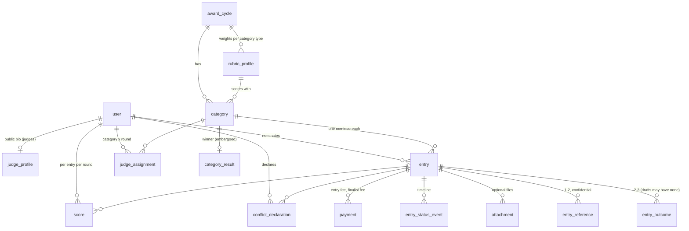

# Pinnacle Awards Platform — Architecture Reference

> Stable "how the system works" reference. Lower-volatility than `docs/status.md`, more detailed than `AGENTS.md`. AGENTS.md holds conventions; this holds the data model, status machines and flows. Update when the architecture changes (and log the decision in `DECISIONS.md`).

## Repo layout

```
src/
  app/                    Next.js routes (thin: auth → service → render)
    api/health/           liveness + DB readiness
  components/             shared UI (header, footer, form primitives)
  lib/                    pure, unit-tested modules: env, csp, (later) pricing, scoring, validation
  server/                 server-only code
    db/                   Drizzle client (index.ts) and schema (schema.ts → tables/*)
  proxy.ts                per-request CSP nonce (+ role redirects from #4)
  instrumentation.ts      validates config at server boot
drizzle/                  generated SQL migrations (forward-only) + drizzle-kit metadata
scripts/                  db-migrate, db-reset, prepare-standalone, ci-local
tests/
  unit/                   pure functions (Vitest)
  integration/            services against real Postgres (Vitest, files run serially)
  e2e/                    Playwright against the production build, with axe checks
docs/ci/ci.yml            the CI workflow (install to .github/workflows/)
```

## Runtime

- **Rendering:** every page is rendered per request (`await connection()` or request APIs), so each response carries a fresh CSP nonce. `cacheComponents` is off: the app's pages are personalized and data-driven, and simple dynamic rendering is easier to maintain.
- **Config:** `src/lib/env.ts` validates every variable with zod. `src/instrumentation.ts` calls it at boot, so a misconfigured deploy fails at start-up.
- **Security headers:** static ones in `next.config.ts` (nosniff, frame DENY, referrer, permissions, COOP, HSTS in production builds). The CSP is built per request in `src/lib/csp.ts`: scripts require the nonce plus `'strict-dynamic'`, `form-action` allows Stripe Checkout, `frame-ancestors 'none'`, and `upgrade-insecure-requests` is set when `APP_URL` is https.
- **Database:** one `pg` pool per process (`src/server/db/index.ts`), Drizzle with `casing: "snake_case"`. Migrations are applied by `npm run db:migrate` (drizzle migrator; safe to run on every deploy).
- **Production artifact:** `next build` with `output: "standalone"`; `scripts/prepare-standalone.mjs` copies static assets; start with `node .next/standalone/server.js`.

## Public site

Pages `/`, `/categories`, `/fees`, `/methodology`, `/judges`, `/conflict-of-interest` render per request from `src/server/services/public-program.ts`, which selects only public columns: the active cycle's dates, fees and phase; enabled categories; rubric weights; judges with `is_public`, `active`, role JUDGE and not disabled. Fees and the current tier come from `entryFeeFor`, and the weights shown are the stored ones the scoring uses. `DEMO_MODE=true` adds a banner saying the data is fictional.

## Admin program settings

`/admin/settings`, `/admin/categories`, `/admin/rubrics` (admin layout + `requireRole` on every page and action) call `src/server/services/program-settings.ts`. Each change locks the active cycle row (`SELECT … FOR UPDATE`), validates (`src/lib/validation/program-settings.ts`), writes, and audits before/after in one transaction. Rules (DECISIONS 006): deadlines entered as Eastern dates and stored as exclusive end-of-day instants, strictly ordered; fees in whole dollars stored as cents, never decreasing from early to late; the window and entry fees are frozen once judging starts and the finalist fee once finalists are announced; opening cannot move later than an already-submitted entry; withdrawing a category locks its row (submission reads it FOR SHARE); rubric weights integers summing to 100 and frozen once the cycle leaves NOMINATION; a category's rubric is frozen too; core categories are always offered; an optional category with submitted entries cannot be withdrawn.

## Nominations

- `/entries` lists the nominator's own entries with status and next step (`src/lib/entry-status.ts`). `/entries/new` starts a draft in an enabled category of the active cycle while the window is open (`startEntry`; nominators only, so judges and admins cannot nominate). `/entries/[id]/edit` edits a DRAFT or RETURNED entry; `/entries/[id]` is the review/status page.
- Validation lives in `src/lib/validation/entry.ts`: `draftSchema` (everything optional, lengths capped) for saving, `submissionSchema` / `readinessProblems` for the program rules (250-500 words, 2-3 outcomes with data points, 1-2 references with contact details, valid nominee email and LinkedIn URL). The review page lists every problem linked to its field.
- `saveDraft` (`src/server/services/entry-drafts.ts`) loads the entry by id and nominator and editable status `FOR UPDATE`, updates it, and replaces outcomes and references as a set in one transaction. The partial unique index on (cycle, category, nominator, lower(nominee email)) becomes a field error.
- Form fields are flat names (`outcomes.1.dataPoint`) parsed by `src/lib/entry-form.ts`; blank optional rows are dropped.

## Supporting files

- **Upload:** the edit page has a plain multipart form posting to `POST /api/entries/[id]/attachments` (works without JavaScript; with it, oversized files are stopped in the browser and the upload is a `fetch` with `x-upload-client: fetch` that gets JSON back, so unsaved edits in the entry form survive). The route is excluded from `proxy.ts` so the proxy does not buffer bodies. Before reading the body it requires `Origin` = `APP_URL` (CSRF), a NOMINATOR session and a `Content-Length` within 10 MB plus a 64 KB envelope. `uploadAttachment` (`src/server/services/attachments.ts`) then checks the size again, takes the type from the file's first bytes (`sniffType` in `src/lib/file-rules.ts`: PDF, PNG, JPEG only; the name and browser MIME type are ignored), checks the owner's DRAFT/RETURNED entry and the 5-file limit, writes the bytes under a random UUID key outside any transaction (a slow bucket never holds a connection or lock), then re-checks under `FOR UPDATE` on the entry and records name, type, size and SHA-256; any refusal after the write removes the bytes. The route redirects back with `?upload=ok` or `?uploadError=<code>`; messages come from a fixed table, never the URL.
- **Storage** (`src/server/storage/index.ts`): `STORAGE_DRIVER=local` writes `STORAGE_DIR/<2 chars>/<key>` (mode 0600, never under `public/`); `s3` uses any S3-compatible bucket with SSE-AES256. Keys are server-generated UUIDs and are validated before use.
- **Download:** `GET /api/attachments/[id]` returns the file only to someone `entryAccessFor` (`src/server/services/entry-access.ts`) allows: the entry's nominator, admins, or a judge assigned to the entry's category who declared no conflict on an APPROVED entry. Everyone else, signed out included, gets 404. Responses are `Content-Disposition: attachment` with an RFC 5987 name, the sniffed `Content-Type`, `nosniff`, `Cache-Control: private, no-store` and a `sandbox` CSP. Admin and judge downloads are audited (`attachment.downloaded`).
- **Removal:** `deleteAttachment` (owner, editable entry) deletes the row, then the bytes; `deleteDraft` removes its files' bytes after the entry is deleted. Byte removal is best effort (`removeBytes`): a failure is logged and leaves an orphan, never a dangling row. Display names have control, reserved and invisible/bidi (`\p{Cf}`) characters removed. Malware scanning is not built (LAUNCH_READINESS).

## Round one: scoring and finalists

- **Phases** (`src/server/services/rounds.ts`, `finalists.ts`, `/admin/judging`): `openRoundOne` (NOMINATION → ROUND1_OPEN) needs the final deadline passed and, when entries are still SUBMITTED/RETURNED, an explicit confirmation that they will not be judged; it locks rubric weights and ends triage. Opening is also refused while any entry-fee checkout can still be paid or confirmed (a late payment would submit an entry after triage; a payment that lands anyway is audited with `afterTriageClosed`). `closeRoundOne` → ROUND1_CLOSED, refused while any entry has fewer than 2 counted scores. `reopenRoundOne` (ROUND1_CLOSED → ROUND1_OPEN, only before announcement, needs a reason) clears saved finalist selections so a late conflict can be covered by another judge. Each locks the active cycle `FOR UPDATE` and is audited. Lock order everywhere is cycle → entry: scoring, conflict changes and triage take the cycle `FOR SHARE` first, so none commits while a phase change or announcement holds the cycle.
- **Scoring** (`src/server/services/scoring.ts`, judge entry page): a judge may score an entry only if `judgeAccess` lets them read it in that round **and** the round is open (`roundOpen`). Four criteria 1-10, optional comment; drafts may be partial, submitting needs all four; a submitted score can be revised until close (saving a draft over it withdraws it). Every save (draft, submission, revision, withdrawal) is audited; the form labels the draft button "Withdraw and save as draft" once a score is submitted. Judges only ever see their own score.
- **Maths** (`src/lib/scoring.ts`, pure): weighted score = Σ(score × weight) / 10 (10-100) with the category's rubric profile; an entry's score is the mean of **submitted** scores from judges **without a conflict** on it (a late conflict drops that judge's score; deactivation or removal does not). Means are rounded half up to 2 decimal places using integers (`meanHundredths`), and ties compare those values; the ranking shows tied entries with a shared rank ("=4") and the population SD.
- **Rankings** (`computeRanking`, `src/server/services/rankings.ts`, `/admin/judging/[categoryId]`): mean, judges counted, standard deviation and which eligible judges have not submitted; entries with fewer than 2 counted scores block selection and announcement.
- **Finalists** (`selectFinalists`): after close, exactly the top N (N = 3-5; all entries when a category has fewer than 3) by mean. The only discretion is among entries tied at the cut-off (`cutoffTie`), which needs a stored, audited reason (`checkSelection`). The selection stores the ranking it was made from (`finalist_selection.ranking`).
- **Announcement** (`announceFinalists`, ROUND1_CLOSED → FINALISTS_ANNOUNCED): every category with approved entries needs a selection that still passes `checkSelection` against the current ranking (a conflict declared after close that changes the ranking forces a re-selection) and no blockers. Then `entry.is_finalist` is set for the chosen entries, and every nominator is emailed (finalists with the finalist package fee). Nominators see "In judging" during round one and "Finalist" / "Not advanced" only after announcement (`nominatorStatus`); round-two judges can declare on finalists only after announcement.

## Judges and conflicts of interest

- **Panel** `/admin/judges` (`src/server/services/judges-admin.ts`, `judge-assignments.ts`): `inviteJudge` creates or promotes the user to JUDGE with a `judge_profile` and emails them; admins cannot also be judges. Profiles (name, title, organization, bio, public, order) feed `/judges`. `setAssignments` replaces one round's categories until that round closes. `setJudgeActive(false)` hides the judge everywhere. **Conflict policy:** granting JUDGE (`grantRole`, `npm run user:role`, `inviteJudge`) or assigning a judge is refused while the person has non-draft entries in the active cycle.
- **The judge rule** (`judgeAccess`, `src/server/services/entry-access.ts`), used by every judge path including file downloads: the judge's profile is active and the entry APPROVED. *Declaring* needs an assignment to the entry's category for round 1, or for round 2 when the entry is a finalist. *Reading* in a round needs that round's assignment, the round to have opened (phase), round 2 only for finalists, and a "no conflict" declaration. Admins and the entry's nominator use `entryAccessFor`.
- **Declarations** (`src/server/services/conflicts.ts`): before reading, a judge answers per entry, seeing only nominee name, title and company (`/judge/categories/[id]?round=`). A conflict needs a reason and is final for the judge; "no conflict" can later become "conflict" (recuses at once; #12 must ignore that judge's scores for the entry). Admins record a recusal or clear a conflict on `/admin/judges/[id]`, always with a reason. Every declaration and override is audited (`conflict.*`); admins see all declarations on the judge page and on each entry's admin page.
- **Judge views** (`src/server/services/judging.ts`): `/judge` lists assigned categories per round with progress (recused entries excluded); `/judge/entries/[id]?round=` shows the nominee, narrative, outcomes, references without contact details, and files. Never the nominee's email, the nominator or payments. Each view is audited (`entry.viewed_by_judge`).
- **Coverage** (`coverageWarnings`): approved entries (round 1) or finalists (round 2) with fewer than 2 eligible judges (assigned, active, enabled, not recused) are listed on `/admin/judges`.

## Eligibility review (triage)

- **Queue** `/admin/entries` (`listTriageQueue`, `src/server/services/triage-queue.ts`): non-draft entries of the active cycle, filtered by status (default "Needs review") and category, sorted by submission date, 25 per page; filters are a plain GET form, validated with fallbacks.
- **Detail** `/admin/entries/[id]` (`getAdminEntry`): nominee, narrative, outcomes, references, files, payments and the status history with who acted. Reference emails and phone numbers are withheld until the admin follows "Show reference contact details" (`?contacts=1`); each such view writes `entry.references_viewed`. File downloads are audited by #8.
- **Approve / return** (`approveEntry`, `returnEntry`, `src/server/services/triage.ts`): lock the cycle `FOR SHARE` and check phase NOMINATION on the locked row (serializes with opening round one), then the entry `FOR UPDATE` (cycle before entry), require SUBMITTED and that no status change happened since the admin's page was rendered (hidden `version`), write a status event with the admin as actor, audit `entry.approved` / `entry.returned`, then email the nominator (dedupe per event). A return needs a reason (incomplete, wrong category, other) and a message the nominator sees; it also stores a keyed HMAC-SHA-256 per content field and for the set of supporting files (`src/server/entry-changes.ts`), never the content, plus the category name so the summary can say "Category (was …)".
- **Returned entries:** editable again. The nominee's email is fixed once an entry has been paid for (the fee covers that nominee); name, title and company can be corrected. Only a "wrong category" return allows `moveReturnedEntry` to another enabled category (duplicate nominee in the target → field error). `resubmitEntry` (nominator) requires the entry complete, its category offered, a PAID entry fee and triage open, moves RETURNED → SUBMITTED with no new payment (keeping the original `submitted_at`, so the entry keeps its place in the queue), records "Changed: …" from the hashes, and emails `ADMIN_NOTIFY_EMAIL` (or every active admin).
- **Nominator view:** `/entries` shows the latest return message; the entry page shows the request, a "Resubmit" button and a history (`getMyTimeline`) without actor identities or internal approval notes.

## Entry fee payment

- **Provider boundary** (`src/server/payments/`): `PaymentProvider` creates hosted checkouts, ends open ones, and verifies and decodes webhook events into a provider-neutral `CheckoutEvent`. `stripe` uses Stripe hosted Checkout (cards only, so a completed session is paid; `expires_at` 31 minutes out, the shortest Stripe accepts plus a minute of margin; idempotency key per payment). `mock` is the app's own `/dev/checkout/<session>` page, which signs a test event (HMAC derived from `BETTER_AUTH_SECRET`) and feeds it through the same verification and fulfilment. The provider is `PAYMENTS_PROVIDER`, else stripe in real production and mock elsewhere. `paymentConfigProblems` (`src/lib/env.ts`) refuses mock in real production, live keys anywhere else, and stripe without both secrets; the server exits at boot on any of these (`src/instrumentation.ts`).
- **Start** (`startCheckout`, `src/server/services/checkout.ts`): in one transaction it locks the owner's DRAFT entry `FOR UPDATE` and its category `FOR SHARE` (must be enabled; serializes with withdrawal), requires the active cycle in NOMINATION with the window open, re-runs `readinessProblems` on the stored entry, refuses if an entry fee is already PAID, asks the provider about every PENDING session whatever its local expiry (expired or ended → EXPIRED locally; completed → refuse, its payment is on its way, so a late webhook can never be followed by a second charge), creates the session at `entryFeeFor(cycle, now)`, and records a PENDING payment with tier, amount and `expires_at`. The client never sends an amount.
- **Frozen while paying:** while a PENDING checkout is unexpired, or expired less than 5 minutes ago (`CONFIRMATION_GRACE_MS`, a last-second payment may still be confirming), `saveDraft`, uploads and file removal refuse, the edit page redirects to the review page, and an admin cannot withdraw the category. The review page offers "Continue to payment" (a new session) or "Cancel the checkout" (`cancelCheckout`).
- **Fulfil** (`handleWebhook`, `src/server/services/payment-events.ts`): verify the signature (bad → 400 + `webhook.rejected` audit, at most 50 audit rows per IP per 15 minutes so forged floods cannot grow the append-only log without bound). In one transaction: record the event id in `webhook_event` (a replay does nothing), lock the entry and then the payment (the same order as start/cancel, so they never deadlock), and for a paid event check amount and currency against what was priced (mismatch → `payment.amount_mismatch` audit, not fulfilled). If another payment of the same kind is already PAID, nothing changes and `payment.duplicate_needs_refund` is audited. Otherwise mark it PAID (paid time, payment intent), move the entry DRAFT → SUBMITTED with a status event, and audit `payment.fulfilled`. A paid event for a session that started inside the window is honoured even after the deadline. After commit, the receipt email (dedupe key per payment); a mail failure is logged and does not fail the webhook. Expired/failed events mark PENDING rows.
- **Routes:** `POST /api/webhooks/stripe` (raw body read with a 256 KB cap, outside the proxy, 404 unless stripe is the provider). The success URL (`/entries/<id>?checkout=done`) only shows status; the cancel URL shows "Payment cancelled".
- **Who sees payments:** the entry's nominator (their entry page: tier, amount, paid time, reference) and admins (`/admin/payments`, `listPayments`). Judges never.

## Authentication and authorization

- **Sign-in** is passwordless (Better Auth magic links, `src/server/auth/auth.ts`). The sign-in form posts to a server action (`src/app/actions/auth.ts` → `src/server/services/sign-in.ts`) that validates and lowercases the email, rate-limits per IP (20/15 min, IPv6 by /64; checked first) and per email (5/15 min) with a sliding window in Postgres (`src/server/rate-limit.ts`, hashed keys). The client IP is the `TRUSTED_PROXY_HOPS`-th `X-Forwarded-For` entry from the right (`src/server/request.ts`); the spoofable leftmost value is never used, and an unknown IP is not bucketed, then asks Better Auth to issue a token (stored hashed, 15-minute expiry, single use). The response is the same whether or not an account exists.
- **The emailed link opens `/sign-in/confirm`**, not the verify endpoint: link scanners (Microsoft Safe Links) open links in mail, and the verify URL would spend the token. The page names the account the token belongs to (looked up by the token's SHA-256 in `verification`) and warns if a different account is signed in. The person presses "Sign in as …", which GETs `/api/auth/magic-link/verify`; the route refuses cross-site requests (`Sec-Fetch-Site`) and requests without `callbackURL` (login-CSRF and token-in-JSON defenses). Better Auth's origin and CSRF checks are forced on and the only trusted origin is `APP_URL`. Better Auth creates the account on first use (role NOMINATOR) and a database session (7 days, refreshed daily), sets an httpOnly, SameSite=Lax cookie prefixed `pinnacle` (Secure when `APP_URL` is https), and redirects to the safe `next` path (`src/lib/paths.ts`).
- **Exposed Better Auth HTTP surface:** only `GET /api/auth/magic-link/verify` (`src/app/api/auth/[...all]/route.ts` allow-list). Sign-out is a server action.
- **Roles** live on `user.role` and are read from the database on every request (`getActor`, no cookie cache), so role changes and `disabled_at` take effect immediately. Disabling a user deletes their sessions, and a `session.create.before` hook stops a previously issued link from creating a new one. Roles change only through `grantRole` (admin service, audited) or `npm run user:role` (CLI, audited). Better Auth's `role` field is `input: false`.
- **Checks:** `proxy.ts` redirects requests without a session cookie away from `/admin`, `/judge`, `/entries` (UX only). Every protected page, action and route calls `requireUser()` / `requireRole()` (`src/server/auth/session.ts`; wrong role → `forbidden()` → 403 page). Every service calls `assertRole()` (`src/server/auth/actor.ts`) again.
- **Audit:** `audit()` (`src/server/audit.ts`) appends to `audit_log` (sign-in, sign-out, role changes, and every later admin/judge action), optionally inside the action's transaction.
- **Email:** `sendEmail()` (`src/server/email/index.ts`) with `EMAIL_TRANSPORT=outbox` (rows are the mail; `/dev/mailbox`) or `smtp` (rows are delivery records without bodies). Real production refuses the outbox. `dedupe_key` makes retries send once.

## Data model

Schema: `src/server/db/tables/*` (re-exported from `src/server/db/schema.ts`). Migrations: `drizzle/` (generated by `npm run db:generate`, plus hand-written ones such as `0002_audit_log_append_only.sql`). All ids are UUIDs except Better Auth's text ids on `user`/`session`/`account`/`verification`. All timestamps are `timestamptz`. Money is integer cents.



| Table | Holds | Who may read |
|---|---|---|
| `user`, `session`, `account`, `verification` | Better Auth identity; `user.role` = NOMINATOR / JUDGE / ADMIN | self, admins |
| `award_cycle` | one awards year: deadlines, fees (cents), phase, publication timestamps; one row `is_active` | public (dates, fees) |
| `rubric_profile` | four integer weights per category type, CHECK sum = 100 | public |
| `category` | 7 core + 2 optional per cycle, enable flag, rubric profile | public (enabled only) |
| `judge_profile` | public name/title/org/bio; shown on `/judges` only when `is_public` | public (if public) |
| `entry` | nominee, narrative, status, finalist flag, finalist-fee waiver | nominator, admins, assigned unrecused judges (no nominator identity) |
| `entry_outcome` | 2-3 outcomes with data points | as entry |
| `entry_reference` | 1-2 references with contact details | nominator, admins; judges see name/title/org/relationship only |
| `attachment` | stored file metadata; bytes in storage under a random key | as entry |
| `entry_status_event` | triage timeline: from → to, actor, return reason, note | admins; nominator sees own without actor |
| `payment` | checkout attempts; amount fixed server-side; partial unique index: one PAID per (entry, kind) | nominator, admins |
| `webhook_event` | processed provider events, PK (provider, id): idempotency | system |
| `judge_assignment` | judge × category × round | admins, the judge |
| `conflict_declaration` | one per judge per entry; `has_conflict` = recused | admins, the judge |
| `score` | four 1-10 criteria per judge/entry/round; CHECK complete when submitted | admins; the judge's own |
| `category_result` | confirmed winner, SCORE or TIEBREAK (reason required) | admins until results are published |
| `audit_log` | append-only (trigger rejects UPDATE/DELETE) | admins |
| `email_outbox` | outgoing mail: dev mailbox / delivery record; optional `dedupe_key` | admins, dev only page |
| `rate_limit_window` | fixed-window counters (hashed keys, no PII) | system |

Policy encoded as constraints: entries stay in their category's cycle and a winner must belong to the result's category (composite FKs); judges' assignments, declarations and scores and confirmed results cannot be deleted by cascading from users, categories or cycles (restrict); emails stored lowercase; one score per judge/entry/round; one conflict declaration per judge/entry; one paid fee per entry and kind; one result per category per cycle; one entry per nominator/nominee email/category; rubric weights sum to 100; deadlines strictly ordered; score criteria 1-10.

## Status machines

**Cycle phase** (`award_cycle.phase`), advanced only by admin actions; the one move back is reopening round one before finalists are announced (ROUND1_CLOSED → ROUND1_OPEN, audited with a reason):

```
NOMINATION ──open round 1──▶ ROUND1_OPEN ──close──▶ ROUND1_CLOSED ──announce finalists──▶ FINALISTS_ANNOUNCED
   ──open round 2──▶ ROUND2_OPEN ──close──▶ ROUND2_CLOSED ──publish results──▶ RESULTS_PUBLISHED
```

During NOMINATION, the nomination window is time-based (`nominations_open_at` ≤ now < `final_deadline`) and triage runs. Opening round 1 locks rubric weights and ends triage.

**Entry status** (`entry.status`):

```
DRAFT ──pay (verified webhook)──▶ SUBMITTED ──admin approve──▶ APPROVED  (eligible for judging)
                                      │
                                      └──admin return (reason)──▶ RETURNED ──nominator resubmits (no new fee)──▶ SUBMITTED
```

**Payment status** (`payment.status`): a row is created PENDING when a checkout session is created (amount and `expires_at` fixed then). The verified webhook moves it to PAID (sets `paid_at`, payment intent id) or EXPIRED/FAILED. Starting a new checkout or cancelling one moves PENDING → EXPIRED once the provider confirms the session can no longer be paid. A paid event for a row that is no longer PENDING is still honoured (money was taken) and flagged in the audit row. A charge that is not applied (duplicate, wrong amount) stays unpaid but keeps its payment intent id, and admins see it as "Charged, needs review". PAID → REFUNDED is reserved for refund handling (manual for now). At most one PAID row per (entry, kind).

**Email status** (`email_outbox.status`): PENDING → SENT (or FAILED with `error`). The outbox transport marks rows SENT on insert; SMTP updates after delivery.

Round outcomes are not statuses: `entry.is_finalist` is the admin's selection, visible outside admin only once the cycle reaches FINALISTS_ANNOUNCED. Winners live in `category_result` and are visible outside admin only at RESULTS_PUBLISHED.

## Seed data

`npm run db:seed` loads fake demo data (`scripts/seed/`): the 2027 cycle, 2 rubric profiles, 9 categories, 1 admin, 6 judges (all public), 12 nominators, 63 entries (7 per category: 45 approved, 9 submitted, 3 returned, 6 drafts), round 1 and 2 judge assignments (two judges per category). Submission dates fall inside the window and each payment carries the tier from `entryFeeFor` at its submission time; self-nominations name the nominator. `--open-now` moves the window so nominations are open today (run `db:reset` before switching modes). `--program-only` loads only the cycle/rubrics/categories. Emails are `example.com`/`example.org` only (a test enforces it). Ids are derived from names, so re-runs insert nothing new.
