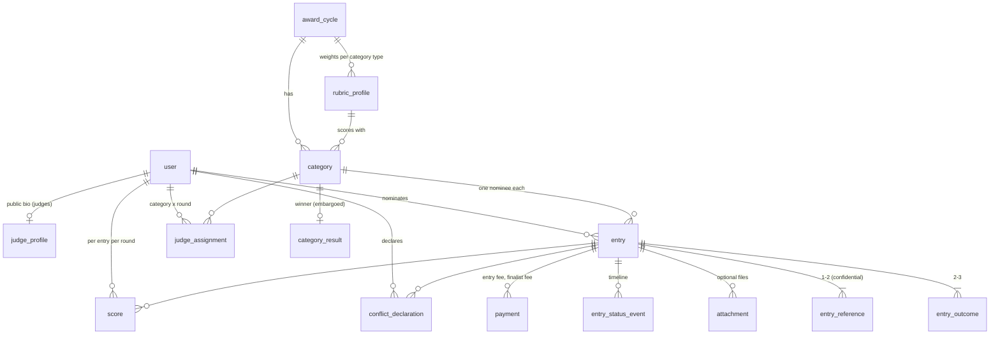

# Pinnacle Awards Platform — Architecture Reference

> Stable "how the system works" reference. Lower-volatility than `docs/status.md`, more detailed than `AGENTS.md`. AGENTS.md holds conventions; this holds the data model, status machines and flows. Update when the architecture changes (and log the decision in `DECISIONS.md`).

## Repo layout

```
src/
  app/                    Next.js routes (thin: auth → service → render)
    api/health/           liveness + DB readiness
  components/             shared UI (header, footer, form primitives)
  lib/                    pure, unit-tested modules: env, csp, (later) pricing, scoring, validation
  server/                 server-only code
    db/                   Drizzle client (index.ts) and schema (schema.ts → tables/*)
  proxy.ts                per-request CSP nonce (+ role redirects from #4)
  instrumentation.ts      validates config at server boot
drizzle/                  generated SQL migrations (forward-only) + drizzle-kit metadata
scripts/                  db-migrate, db-reset, prepare-standalone, ci-local
tests/
  unit/                   pure functions (Vitest)
  integration/            services against real Postgres (Vitest, files run serially)
  e2e/                    Playwright against the production build, with axe checks
docs/ci/ci.yml            the CI workflow (install to .github/workflows/)
```

## Runtime

- **Rendering:** every page is rendered per request (`await connection()` or request APIs), so each response carries a fresh CSP nonce. `cacheComponents` is off: the app's pages are personalized and data-driven, and simple dynamic rendering is easier to maintain.
- **Config:** `src/lib/env.ts` validates every variable with zod. `src/instrumentation.ts` calls it at boot, so a misconfigured deploy fails at start-up.
- **Security headers:** static ones in `next.config.ts` (nosniff, frame DENY, referrer, permissions, COOP, HSTS in production builds). The CSP is built per request in `src/lib/csp.ts`: scripts require the nonce plus `'strict-dynamic'`, `form-action` allows Stripe Checkout, `frame-ancestors 'none'`, and `upgrade-insecure-requests` is set when `APP_URL` is https.
- **Database:** one `pg` pool per process (`src/server/db/index.ts`), Drizzle with `casing: "snake_case"`. Migrations are applied by `npm run db:migrate` (drizzle migrator; safe to run on every deploy).
- **Production artifact:** `next build` with `output: "standalone"`; `scripts/prepare-standalone.mjs` copies static assets; start with `node .next/standalone/server.js`.

## Data model

Schema: `src/server/db/tables/*` (re-exported from `src/server/db/schema.ts`). Migrations: `drizzle/` (generated by `npm run db:generate`, plus hand-written ones such as `0002_audit_log_append_only.sql`). All ids are UUIDs except Better Auth's text ids on `user`/`session`/`account`/`verification`. All timestamps are `timestamptz`. Money is integer cents.



| Table | Holds | Who may read |
|---|---|---|
| `user`, `session`, `account`, `verification` | Better Auth identity; `user.role` = NOMINATOR / JUDGE / ADMIN | self, admins |
| `award_cycle` | one awards year: deadlines, fees (cents), phase, publication timestamps; one row `is_active` | public (dates, fees) |
| `rubric_profile` | four integer weights per category type, CHECK sum = 100 | public |
| `category` | 7 core + 2 optional per cycle, enable flag, rubric profile | public (enabled only) |
| `judge_profile` | public name/title/org/bio; shown on `/judges` only when `is_public` | public (if public) |
| `entry` | nominee, narrative, status, finalist flag, finalist-fee waiver | nominator, admins, assigned unrecused judges (no nominator identity) |
| `entry_outcome` | 2-3 outcomes with data points | as entry |
| `entry_reference` | 1-2 references with contact details | nominator, admins; judges see name/title/org/relationship only |
| `attachment` | stored file metadata; bytes in storage under a random key | as entry |
| `entry_status_event` | triage timeline: from → to, actor, return reason, note | admins; nominator sees own without actor |
| `payment` | checkout attempts; amount fixed server-side; partial unique index: one PAID per (entry, kind) | nominator, admins |
| `webhook_event` | processed provider event ids (idempotency) | system |
| `judge_assignment` | judge × category × round | admins, the judge |
| `conflict_declaration` | one per judge per entry; `has_conflict` = recused | admins, the judge |
| `score` | four 1-10 criteria per judge/entry/round; CHECK complete when submitted | admins; the judge's own |
| `category_result` | confirmed winner, SCORE or TIEBREAK (reason required) | admins until results are published |
| `audit_log` | append-only (trigger rejects UPDATE/DELETE) | admins |
| `email_outbox` | outgoing mail (dev mailbox / delivery record) | admins, dev only page |
| `rate_limit` | fixed-window counters | system |

Policy encoded as constraints: one score per judge/entry/round; one conflict declaration per judge/entry; one paid fee per entry and kind; one result per category per cycle; one entry per nominator/nominee email/category; rubric weights sum to 100; deadlines strictly ordered; score criteria 1-10.

## Status machines

**Cycle phase** (`award_cycle.phase`), advanced only by admin actions, never backwards:

```
NOMINATION ──open round 1──▶ ROUND1_OPEN ──close──▶ ROUND1_CLOSED ──announce finalists──▶ FINALISTS_ANNOUNCED
   ──open round 2──▶ ROUND2_OPEN ──close──▶ ROUND2_CLOSED ──publish results──▶ RESULTS_PUBLISHED
```

During NOMINATION, the nomination window is time-based (`nominations_open_at` ≤ now < `final_deadline`) and triage runs. Opening round 1 locks rubric weights and ends triage.

**Entry status** (`entry.status`):

```
DRAFT ──pay (verified webhook)──▶ SUBMITTED ──admin approve──▶ APPROVED  (eligible for judging)
                                      │
                                      └──admin return (reason)──▶ RETURNED ──nominator resubmits (no new fee)──▶ SUBMITTED
```

Round outcomes are not statuses: `entry.is_finalist` is the admin's selection, visible outside admin only once the cycle reaches FINALISTS_ANNOUNCED. Winners live in `category_result` and are visible outside admin only at RESULTS_PUBLISHED.

## Seed data

`npm run db:seed` loads fake demo data (`scripts/seed/`): the 2027 cycle, 2 rubric profiles, 9 categories, 1 admin, 6 judges (5 public), 12 nominators, 30 entries (16 approved, 6 submitted, 3 returned, 5 drafts), round 1 and 2 judge assignments (two judges per category). `--open-now` moves the window so nominations are open today. `--program-only` loads only the cycle/rubrics/categories. Emails are `example.com`/`example.org` only (a test enforces it). Ids are derived from names, so re-runs insert nothing new.
