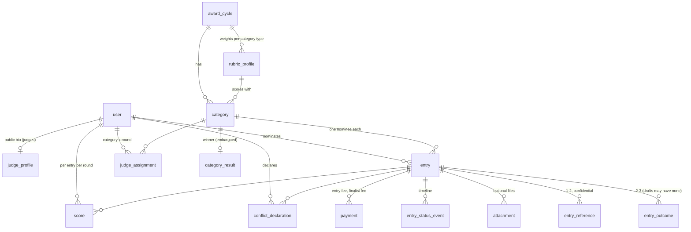

# Pinnacle Awards Platform — Architecture Reference

> Stable "how the system works" reference. Lower-volatility than `docs/status.md`, more detailed than `AGENTS.md`. AGENTS.md holds conventions; this holds the data model, status machines and flows. Update when the architecture changes (and log the decision in `DECISIONS.md`).

## Repo layout

```
src/
  app/                    Next.js routes (thin: auth → service → render)
    api/health/           liveness + DB readiness
  components/             shared UI (header, footer, form primitives)
  lib/                    pure, unit-tested modules: env, csp, (later) pricing, scoring, validation
  server/                 server-only code
    db/                   Drizzle client (index.ts) and schema (schema.ts → tables/*)
  proxy.ts                per-request CSP nonce (+ role redirects from #4)
  instrumentation.ts      validates config at server boot
drizzle/                  generated SQL migrations (forward-only) + drizzle-kit metadata
scripts/                  db-migrate, db-reset, prepare-standalone, ci-local
tests/
  unit/                   pure functions (Vitest)
  integration/            services against real Postgres (Vitest, files run serially)
  e2e/                    Playwright against the production build, with axe checks
docs/ci/ci.yml            the CI workflow (install to .github/workflows/)
```

## Runtime

- **Rendering:** every page is rendered per request (`await connection()` or request APIs), so each response carries a fresh CSP nonce. `cacheComponents` is off: the app's pages are personalized and data-driven, and simple dynamic rendering is easier to maintain.
- **Config:** `src/lib/env.ts` validates every variable with zod. `src/instrumentation.ts` calls it at boot, so a misconfigured deploy fails at start-up.
- **Security headers:** static ones in `next.config.ts` (nosniff, frame DENY, referrer, permissions, COOP, HSTS in production builds). The CSP is built per request in `src/lib/csp.ts`: scripts require the nonce plus `'strict-dynamic'`, `form-action` allows Stripe Checkout, `frame-ancestors 'none'`, and `upgrade-insecure-requests` is set when `APP_URL` is https.
- **Database:** one `pg` pool per process (`src/server/db/index.ts`), Drizzle with `casing: "snake_case"`. Migrations are applied by `npm run db:migrate` (drizzle migrator; safe to run on every deploy).
- **Production artifact:** `next build` with `output: "standalone"`; `scripts/prepare-standalone.mjs` copies static assets; start with `node .next/standalone/server.js`.

## Authentication and authorization

- **Sign-in** is passwordless (Better Auth magic links, `src/server/auth/auth.ts`). The sign-in form posts to a server action (`src/app/actions/auth.ts` → `src/server/services/sign-in.ts`) that validates and lowercases the email, rate-limits per email (5/15 min) and per IP (20/15 min) in Postgres (`src/server/rate-limit.ts`, hashed keys), then asks Better Auth to issue a token (stored hashed, 15-minute expiry, single use). The response is the same whether or not an account exists.
- **The emailed link opens `/sign-in/confirm`**, not the verify endpoint: link scanners (Microsoft Safe Links) open links in mail, and the verify URL would spend the token. The person presses "Sign in", which GETs `/api/auth/magic-link/verify`. Better Auth creates the account on first use (role NOMINATOR) and a database session (7 days, refreshed daily), sets an httpOnly, SameSite=Lax cookie prefixed `pinnacle` (Secure when `APP_URL` is https), and redirects to the safe `next` path (`src/lib/paths.ts`).
- **Exposed Better Auth HTTP surface:** only `GET /api/auth/magic-link/verify` (`src/app/api/auth/[...all]/route.ts` allow-list). Sign-out is a server action.
- **Roles** live on `user.role` and are read from the database on every request (`getActor`, no cookie cache), so role changes and `disabled_at` take effect immediately. Roles change only through `grantRole` (admin service, audited) or `npm run user:role` (CLI, audited). Better Auth's `role` field is `input: false`.
- **Checks:** `proxy.ts` redirects requests without a session cookie away from `/admin`, `/judge`, `/entries` (UX only). Every protected page, action and route calls `requireUser()` / `requireRole()` (`src/server/auth/session.ts`; wrong role → `forbidden()` → 403 page). Every service calls `assertRole()` (`src/server/auth/actor.ts`) again.
- **Audit:** `audit()` (`src/server/audit.ts`) appends to `audit_log` (sign-in, sign-out, role changes, and every later admin/judge action), optionally inside the action's transaction.
- **Email:** `sendEmail()` (`src/server/email/index.ts`) with `EMAIL_TRANSPORT=outbox` (rows are the mail; `/dev/mailbox`) or `smtp` (rows are delivery records without bodies). Real production refuses the outbox. `dedupe_key` makes retries send once.

## Data model

Schema: `src/server/db/tables/*` (re-exported from `src/server/db/schema.ts`). Migrations: `drizzle/` (generated by `npm run db:generate`, plus hand-written ones such as `0002_audit_log_append_only.sql`). All ids are UUIDs except Better Auth's text ids on `user`/`session`/`account`/`verification`. All timestamps are `timestamptz`. Money is integer cents.



| Table | Holds | Who may read |
|---|---|---|
| `user`, `session`, `account`, `verification` | Better Auth identity; `user.role` = NOMINATOR / JUDGE / ADMIN | self, admins |
| `award_cycle` | one awards year: deadlines, fees (cents), phase, publication timestamps; one row `is_active` | public (dates, fees) |
| `rubric_profile` | four integer weights per category type, CHECK sum = 100 | public |
| `category` | 7 core + 2 optional per cycle, enable flag, rubric profile | public (enabled only) |
| `judge_profile` | public name/title/org/bio; shown on `/judges` only when `is_public` | public (if public) |
| `entry` | nominee, narrative, status, finalist flag, finalist-fee waiver | nominator, admins, assigned unrecused judges (no nominator identity) |
| `entry_outcome` | 2-3 outcomes with data points | as entry |
| `entry_reference` | 1-2 references with contact details | nominator, admins; judges see name/title/org/relationship only |
| `attachment` | stored file metadata; bytes in storage under a random key | as entry |
| `entry_status_event` | triage timeline: from → to, actor, return reason, note | admins; nominator sees own without actor |
| `payment` | checkout attempts; amount fixed server-side; partial unique index: one PAID per (entry, kind) | nominator, admins |
| `webhook_event` | processed provider events, PK (provider, id): idempotency | system |
| `judge_assignment` | judge × category × round | admins, the judge |
| `conflict_declaration` | one per judge per entry; `has_conflict` = recused | admins, the judge |
| `score` | four 1-10 criteria per judge/entry/round; CHECK complete when submitted | admins; the judge's own |
| `category_result` | confirmed winner, SCORE or TIEBREAK (reason required) | admins until results are published |
| `audit_log` | append-only (trigger rejects UPDATE/DELETE) | admins |
| `email_outbox` | outgoing mail: dev mailbox / delivery record; optional `dedupe_key` | admins, dev only page |
| `rate_limit_window` | fixed-window counters (hashed keys, no PII) | system |

Policy encoded as constraints: entries stay in their category's cycle and a winner must belong to the result's category (composite FKs); judges' assignments, declarations and scores and confirmed results cannot be deleted by cascading from users, categories or cycles (restrict); emails stored lowercase; one score per judge/entry/round; one conflict declaration per judge/entry; one paid fee per entry and kind; one result per category per cycle; one entry per nominator/nominee email/category; rubric weights sum to 100; deadlines strictly ordered; score criteria 1-10.

## Status machines

**Cycle phase** (`award_cycle.phase`), advanced only by admin actions, never backwards:

```
NOMINATION ──open round 1──▶ ROUND1_OPEN ──close──▶ ROUND1_CLOSED ──announce finalists──▶ FINALISTS_ANNOUNCED
   ──open round 2──▶ ROUND2_OPEN ──close──▶ ROUND2_CLOSED ──publish results──▶ RESULTS_PUBLISHED
```

During NOMINATION, the nomination window is time-based (`nominations_open_at` ≤ now < `final_deadline`) and triage runs. Opening round 1 locks rubric weights and ends triage.

**Entry status** (`entry.status`):

```
DRAFT ──pay (verified webhook)──▶ SUBMITTED ──admin approve──▶ APPROVED  (eligible for judging)
                                      │
                                      └──admin return (reason)──▶ RETURNED ──nominator resubmits (no new fee)──▶ SUBMITTED
```

**Payment status** (`payment.status`): a row is created PENDING when a checkout session is created (amount fixed then). The verified webhook moves it to PAID (sets `paid_at`, payment intent id) or EXPIRED/FAILED. PAID → REFUNDED only from a refund webhook. At most one PAID row per (entry, kind).

**Email status** (`email_outbox.status`): PENDING → SENT (or FAILED with `error`). The outbox transport marks rows SENT on insert; SMTP updates after delivery.

Round outcomes are not statuses: `entry.is_finalist` is the admin's selection, visible outside admin only once the cycle reaches FINALISTS_ANNOUNCED. Winners live in `category_result` and are visible outside admin only at RESULTS_PUBLISHED.

## Seed data

`npm run db:seed` loads fake demo data (`scripts/seed/`): the 2027 cycle, 2 rubric profiles, 9 categories, 1 admin, 6 judges (all public), 12 nominators, 63 entries (7 per category: 45 approved, 9 submitted, 3 returned, 6 drafts), round 1 and 2 judge assignments (two judges per category). Submission dates fall inside the window and each payment carries the tier from `entryFeeFor` at its submission time; self-nominations name the nominator. `--open-now` moves the window so nominations are open today (run `db:reset` before switching modes). `--program-only` loads only the cycle/rubrics/categories. Emails are `example.com`/`example.org` only (a test enforces it). Ids are derived from names, so re-runs insert nothing new.
